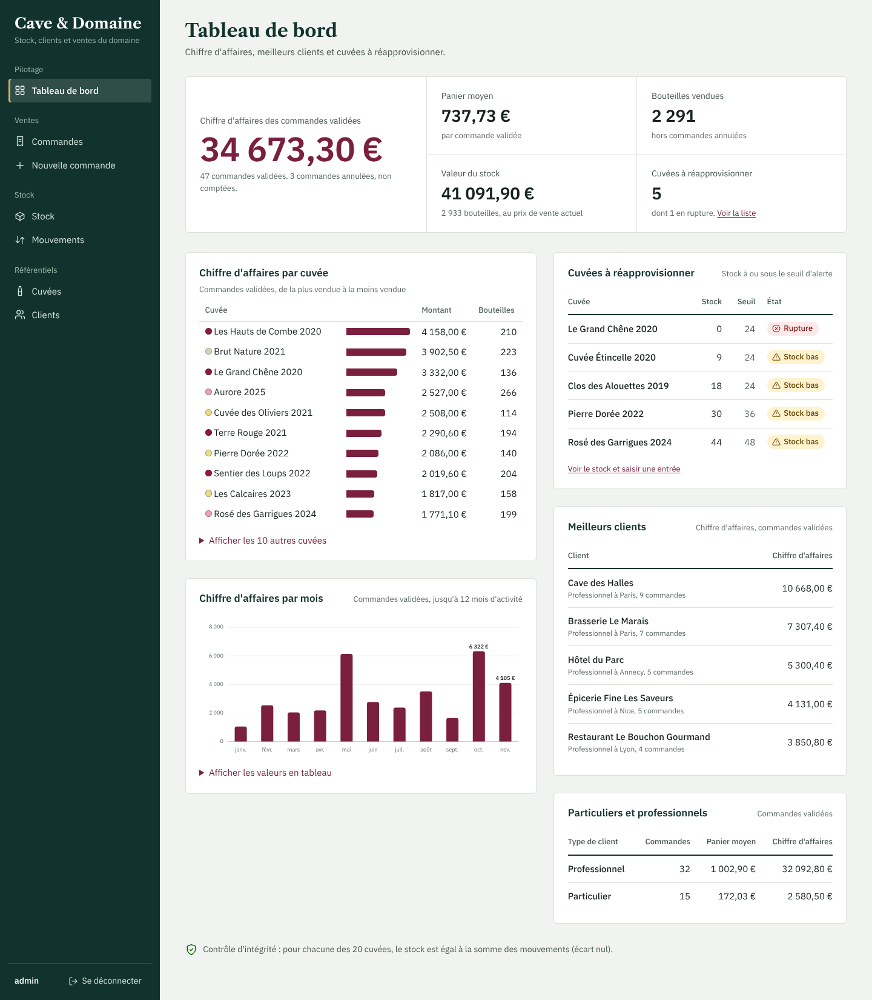
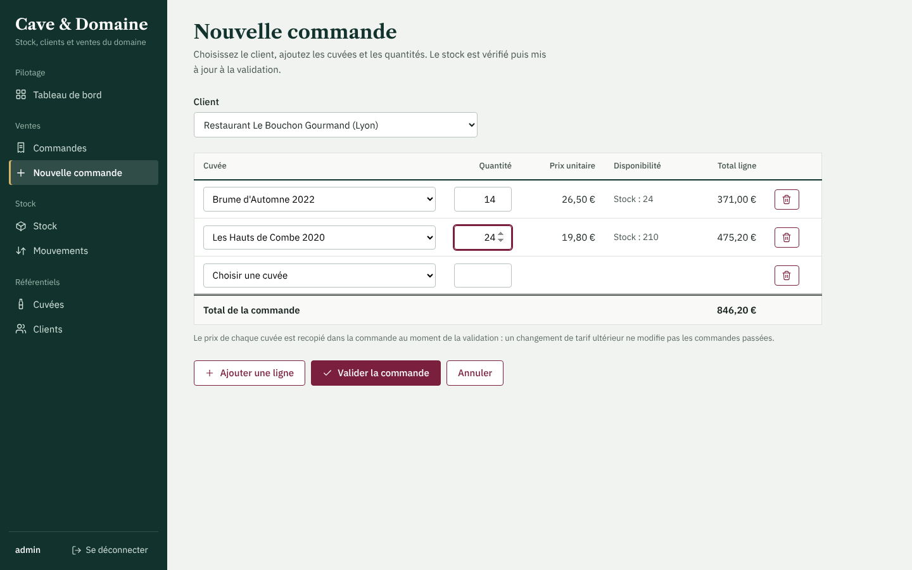
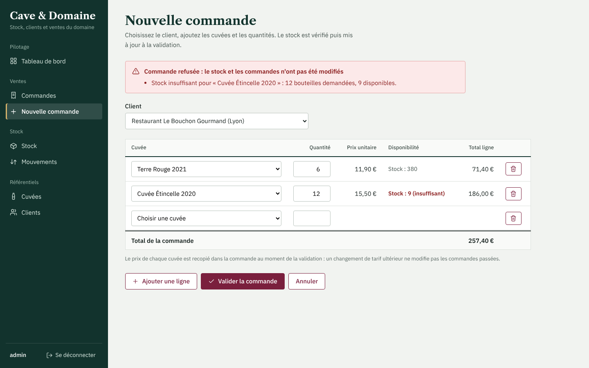
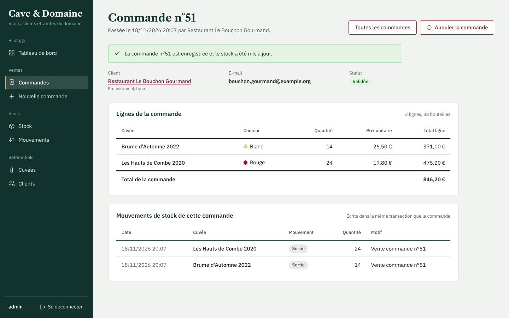
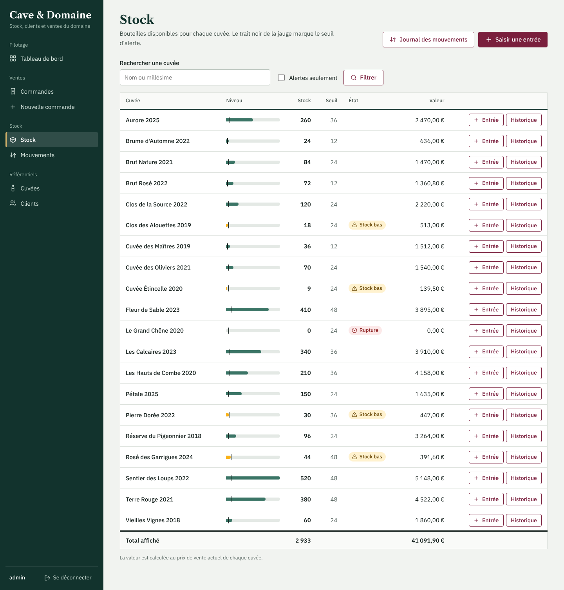
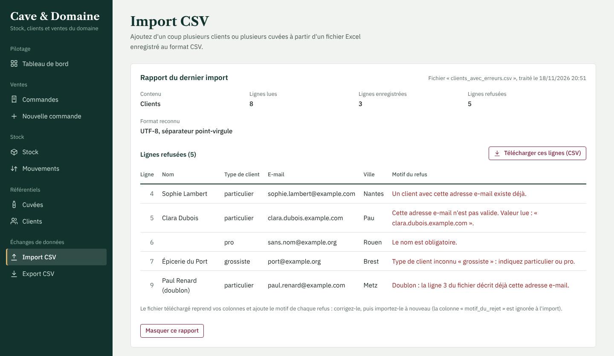
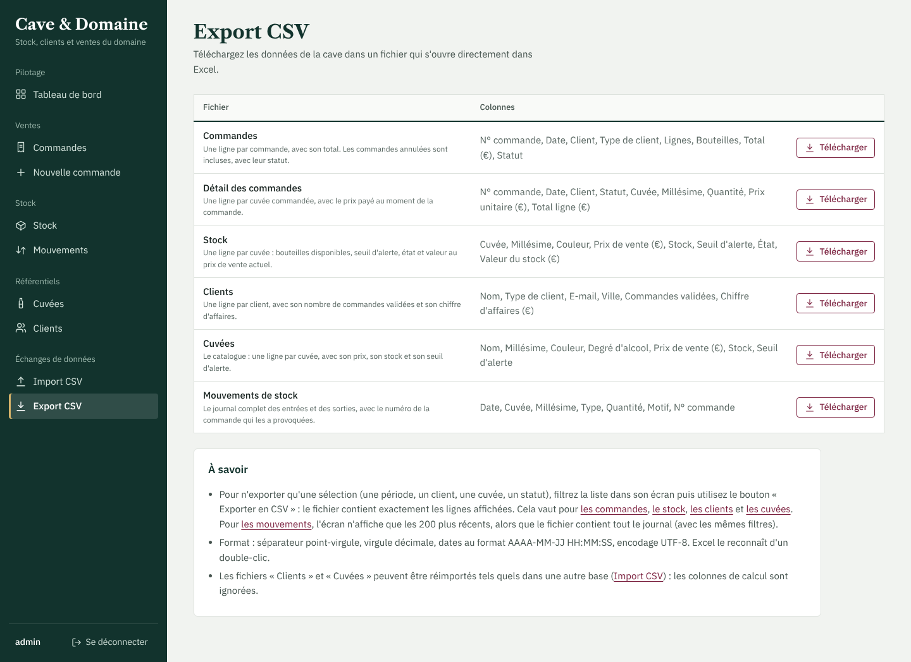
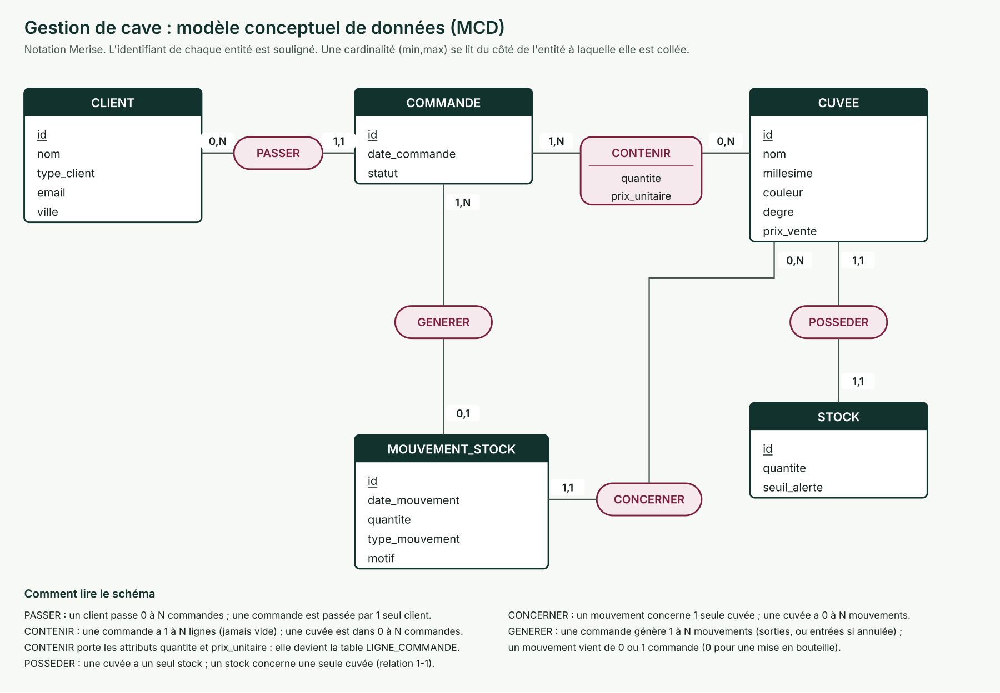

# Cave & Domaine : gestion de cave

Application web de gestion du **stock**, des **clients** et des **commandes** d'un domaine viticole. Projet de démonstration en **PHP 8** et **MySQL / MariaDB**, sans framework ni bibliothèque externe, qui reproduit en version simple ce que fait un ERP pour le vin et le négoce.



**Ce qui la distingue :** quand une commande est validée, le stock baisse automatiquement ; si le stock est insuffisant, la commande est **refusée et la base n'est pas modifiée**. Les prix sont recopiés dans la commande, le stock est tracé par un journal de mouvements, et chaque règle de gestion est vérifiée par des tests automatiques (y compris des commandes simultanées). Pour échanger avec un autre outil, par exemple un ERP, un **import CSV** applique les mêmes règles que les formulaires (et explique chaque ligne refusée) et un **export CSV** reprend exactement ce que l'écran affiche.

## Fonctionnalités

| N° | Fonctionnalité | Pages | État |
|---|---|---|---|
| F1 | Cuvées : ajouter, modifier, supprimer (nom, millésime, couleur, degré, prix) | `cuvees.php`, `cuvee_form.php` | Fait |
| F2 | Stock : consulter, saisir une entrée (mise en bouteille), alerte sous un seuil, journal des mouvements | `stock.php`, `stock_entree.php`, `mouvements.php` | Fait |
| F3 | Clients : ajouter, modifier, rechercher (particulier ou professionnel) | `clients.php`, `client_form.php` | Fait |
| F4 | Commande : client, lignes (cuvée, quantité), total calculé en direct | `commande_nouvelle.php` | Fait |
| F5 | Le stock baisse à la validation ; refus si le stock est insuffisant ; annulation qui remet le stock | `commande_voir.php`, `commande_annuler.php` | Fait |
| F6 | Tableau de bord : chiffre d'affaires par cuvée et par mois, meilleurs clients, stock bas | `index.php` | Fait |
| F7 | Import CSV de clients ou de cuvées, avec rapport d'erreurs (motif de chaque ligne refusée, fichier des refus à corriger, mode simulation) | `import.php`, `import_rejets.php` | Fait |
| F8 | Filtres des commandes par date, client, cuvée et statut | `commandes.php` | Fait |
| F9 | Export CSV : commandes, détail des commandes, stock, clients, cuvées, mouvements (les filtres de l'écran sont respectés) | `export.php`, `export_csv.php` | Fait |

Règles de gestion appliquées : une commande a au moins une ligne ; chaque quantité est un entier strictement positif ; une commande ne peut pas dépasser le stock ; le prix de vente est recopié dans la ligne de commande.

## Captures d'écran

**Saisie d'une commande** : prix, disponibilité et total se mettent à jour en direct.



**Commande refusée** : douze bouteilles demandées pour neuf en stock. Rien n'est enregistré, y compris la ligne correcte.



**Fiche de commande** : prix du jour conservé et mouvements de stock écrits dans la même transaction.



**Stock** : jauge avec le seuil d'alerte, états *Stock bas* et *Rupture*.



## Import et export CSV

**Import** : menu *Import CSV*, ou bouton *Importer un CSV* dans les écrans Clients et Cuvées. Il ajoute d'un coup plusieurs clients ou plusieurs cuvées à partir d'un fichier Excel enregistré au format CSV. Ci-dessous, le rapport obtenu avec `modeles/clients_avec_erreurs.csv` : 3 clients ajoutés, 5 lignes refusées, chacune pour une raison différente.



- Chaque ligne est vérifiée avec **les mêmes règles que les formulaires**. Les lignes valides sont enregistrées ; les autres sont listées avec leur numéro de ligne et leur **motif** (e-mail invalide, type ou couleur inconnu, valeur hors limites, doublon dans le fichier, client ou cuvée déjà en base). Une ligne refusée n'empêche pas d'importer les autres.
- Le bouton *Télécharger ces lignes (CSV)* produit un fichier qui reprend les colonnes d'origine plus le motif de chaque refus : on le corrige dans Excel, puis on le réimporte tel quel.
- La case *Simuler seulement* vérifie le fichier et affiche le rapport **sans rien enregistrer**.
- La lecture est tolérante : séparateur (point-virgule, virgule ou tabulation) et encodage (UTF-8, Windows-1252 ou UTF-16) reconnus automatiquement, colonnes dans n'importe quel ordre, colonnes inconnues ignorées, valeurs comme `12,50 €`, `13 %` ou `Rosé` acceptées.
- Les lignes valides sont écrites dans **une seule transaction** : une panne technique en cours d'import n'en laisse aucune moitié enregistrée. Un stock initial supérieur à 0 passe par le journal des mouvements (« Mise en bouteille »), donc le stock reste égal à la somme des mouvements.
- Limites par défaut : 5 000 lignes et 2 Mo par fichier (section `import` de `config/config.php`).
- Le dossier `modeles/` contient, pour les clients et pour les cuvées, un **modèle à compléter** et un **exemple avec des erreurs**. Ils sont aussi téléchargeables depuis la page d'import.

**Export** : menu *Export CSV*, ou bouton *Exporter en CSV* de chaque écran (commandes, stock, clients, cuvées, mouvements).



- Six fichiers : commandes (avec leur total), détail des commandes (une ligne par cuvée, avec le prix payé), stock, clients (avec leur chiffre d'affaires), cuvées et mouvements de stock.
- Un export lancé depuis un écran filtré contient **exactement les lignes affichées**, dans le même ordre (par exemple les commandes d'un client sur une période) : les fichiers sont produits par les mêmes fonctions que les écrans. Seule différence : l'écran des mouvements n'affiche que les 200 plus récents, alors que le fichier contient tout le journal.
- Format « Excel français » : séparateur point-virgule, virgule décimale, dates `AAAA-MM-JJ HH:MM:SS` (reconnues par Excel quelle que soit la langue), UTF-8 avec BOM. Le fichier s'ouvre d'un double-clic.
- Un texte qui commence par `=`, `+`, `-` ou `@` est précédé d'une apostrophe, pour qu'Excel ne l'exécute pas comme une formule (les nombres ne sont pas modifiés).
- Les exports « Clients » et « Cuvées » se réimportent tels quels dans une autre base : les colonnes de calcul sont ignorées.

## Installation sur XAMPP

Prérequis : [XAMPP](https://www.apachefriends.org) avec PHP 8.0 ou plus récent (PHP 8.3 et MariaDB 10.11 ont servi aux tests).

1. **Copier le projet** dans le dossier `htdocs` de XAMPP, de façon à obtenir `C:\xampp\htdocs\gestion-cave\` (`/Applications/XAMPP/xamppfiles/htdocs/` sous macOS, `/opt/lampp/htdocs/` sous Linux). Depuis GitHub : *Code*, *Download ZIP*, puis décompresser ; ou `git clone` dans `htdocs`.
2. **Démarrer Apache et MySQL** avec le panneau de contrôle XAMPP (boutons *Start*).
3. **Créer la base** : ouvrir `http://localhost/phpmyadmin`, onglet *Importer*, choisir le fichier `database/install_complet.sql`, cliquer sur *Importer*. Le script crée la base `gestion_cave`, ses 6 tables, ses 4 vues et les données de démonstration (20 cuvées, 15 clients, 50 commandes).
4. **Ouvrir l'application** : `http://localhost/gestion-cave/`. Compte de démonstration : **`admin`** / **`cave2026`**.
5. **Vérifier l'installation** : `http://localhost/gestion-cave/verif.php` contrôle PHP, la connexion, les tables, les vues, les contraintes, les données et l'envoi de fichiers (import CSV), et indique quoi corriger en cas de problème.

Variante en ligne de commande pour l'étape 3 :

```
C:\xampp\mysql\bin\mysql.exe -u root --default-character-set=utf8mb4 -e "source C:/xampp/htdocs/gestion-cave/database/install_complet.sql"
```

Autre solution sans Apache (pour une démonstration locale uniquement), depuis le dossier du projet : `C:\xampp\php\php.exe -S localhost:8000`, puis `http://localhost:8000/`.

**Remettre la démonstration à zéro :** réimporter `database/install_complet.sql` (le script supprime et recrée toutes les tables).

## Configuration

Les valeurs par défaut sont celles d'un XAMPP standard : MySQL sur le port 3306, utilisateur `root` sans mot de passe. Pour les changer **sans modifier `config/config.php`**, créer le fichier `config/config.local.php` (ignoré par Git) qui ne contient que les clés à remplacer :

```php
<?php
return [
    'db'   => ['port' => 3307, 'pass' => 'mon_mot_de_passe'],   // autre port ou mot de passe root
    'auth' => ['enabled' => false],                              // désactive la page de connexion
];
```

Pour changer le mot de passe du compte, générer un hash puis le placer dans `config.local.php` sous `'auth' => ['password_hash' => '…']` :

```
C:\xampp\php\php.exe -r "echo password_hash('nouveau_mot_de_passe', PASSWORD_DEFAULT);"
```

La clé `'debug' => true` affiche le détail des erreurs techniques ; à réserver au développement. La clé `'auth' => ['indice' => '']` supprime l'indication du compte de démonstration sous le formulaire de connexion.

## Dépannage

Quand l'application affiche **« Base de données inaccessible »**, cliquer sur *Lancer la vérification d'installation* (ou ouvrir `verif.php`) : la ligne en rouge donne le message exact de MySQL. Ensuite :

| Message ou symptôme | Cause probable | Solution |
|---|---|---|
| `could not find driver`, ou « l'extension PDO MySQL est absente » | L'extension `pdo_mysql` est désactivée | Dans `php.ini` (panneau XAMPP, *Config* d'Apache), vérifier que la ligne `extension=pdo_mysql` n'est pas précédée d'un `;`, puis redémarrer Apache |
| `[2002]` ou « Connection refused » | MySQL n'est pas démarré, ou il écoute sur un autre port | Démarrer MySQL ; si le panneau XAMPP affiche un autre port (souvent 3307), l'indiquer dans `config/config.local.php` |
| `Access denied for user 'root'` | Le compte `root` a un mot de passe | Renseigner `'pass'` dans `config/config.local.php` |
| `Unknown database 'gestion_cave'` | La base n'a pas été importée | Refaire l'étape 3 de l'installation |
| Page sans mise en forme | L'adresse est incorrecte (fichier ouvert directement) | Utiliser `http://localhost/gestion-cave/` et non un chemin de fichier |
| Erreur 404 | Le dossier porte un autre nom | L'adresse suit le nom du dossier : `http://localhost/<nom-du-dossier>/` |
| Page blanche ou « Une erreur est survenue » | Erreur PHP dont le détail est masqué | Mettre `'debug' => true` dans `config.local.php`, ou lire `xampp\apache\logs\error.log` |
| « Le fichier est trop volumineux » à l'import | Le fichier dépasse 2 Mo (limite de l'application) ou la limite d'envoi de PHP | Découper le fichier ; ou régler `upload_max_filesize` et `post_max_size` dans `php.ini`, puis redémarrer Apache (`verif.php` affiche la limite en vigueur) |
| Un import affiche « Colonne obligatoire absente » | La première ligne du fichier ne contient pas les titres attendus | Reprendre les titres du modèle de `modeles/` (l'ordre des colonnes est libre) |

## Tests automatiques

```
php tests/run.php
```

Sous XAMPP / Windows, depuis le dossier du projet : `C:\xampp\php\php.exe tests\run.php`. La suite lance **293 vérifications en 4 secondes environ** sur une base séparée, `gestion_cave_test`, créée puis supprimée : la base de démonstration n'est jamais touchée. Elle couvre les contraintes de la base, les cuvées, le stock, les clients, la saisie de commande, les **refus qui ne modifient rien**, l'annulation, les filtres, le tableau de bord, les 10 requêtes d'analyse, les commandes simultanées, les tentatives d'injection, ainsi que l'**import CSV** (refus expliqués, tout ou rien en cas de panne, stock cohérent) et l'**export CSV** (contenu recoupé avec des requêtes SQL directes, filtres, protection contre les formules). Les tests ont été exécutés sous Linux avec PHP 8.3 et MariaDB 10.11.

## Structure du projet

```
gestion-cave/
├── index.php                  Tableau de bord (F6)
├── cuvees.php  cuvee_form.php  cuvee_supprimer.php          Cuvées (F1)
├── stock.php  stock_entree.php  mouvements.php              Stock (F2)
├── clients.php  client_form.php                              Clients (F3)
├── commande_nouvelle.php  commande_voir.php                  Commandes (F4, F5)
├── commande_annuler.php  commandes.php                       Annulation, liste et filtres (F8)
├── import.php  import_rejets.php                             Import CSV et téléchargement des lignes refusées (F7)
├── export.php  export_csv.php                                Liste des exports et téléchargement CSV (F9)
├── login.php  logout.php  verif.php                          Connexion et contrôle de l'installation
├── src/            Logique : règles de gestion et requêtes SQL, un fichier par domaine
│                   (csv.php, import.php et export.php pour les échanges de fichiers)
├── config/         Configuration (config.php ; config.local.php pour vos réglages)
├── database/       01_schema.sql, 02_vues.sql, 03_donnees_test.sql, 04_requetes.sql,
│                   install_complet.sql (les trois premiers en un seul fichier)
├── modeles/        Fichiers CSV d'exemple : modèles à compléter et exemples avec des erreurs
├── assets/         Feuille de style, JavaScript, polices (aucune ressource externe)
├── tests/          Tests automatiques
├── tools/          Générateurs : données de test, schéma MCD
└── docs/           Documentation
```

## Modèle de données



6 tables : `cuvee`, `stock`, `client`, `commande`, `ligne_commande`, `mouvement_stock`, et 4 vues (`v_commande_total`, `v_ca_par_cuvee`, `v_stock_bas`, `v_controle_stock`). 8 contraintes `CHECK` (quantités et prix strictement positifs, stock jamais négatif…), des clés étrangères et des contraintes d'unicité.

## Documentation

| Document | Contenu |
|---|---|
| [`docs/MLD.md`](docs/MLD.md) | Du MCD au modèle logique, diagramme relationnel, choix de modélisation |
| [`docs/DICTIONNAIRE_DONNEES.md`](docs/DICTIONNAIRE_DONNEES.md) | Chaque table, chaque colonne, chaque règle |
| [`docs/EXPLICATIONS.md`](docs/EXPLICATIONS.md) | Chaque table, chaque vue et chaque requête expliquées ; la transaction qui protège le stock ; sécurité ; questions probables |
| [`docs/DEMO_5_MIN.md`](docs/DEMO_5_MIN.md) | Script de démonstration minuté, préparation et plan de secours |
| [`database/04_requetes.sql`](database/04_requetes.sql) | Les 10 requêtes d'analyse (jointures et agrégats), à exécuter dans phpMyAdmin |

## Choix techniques

- **Requêtes préparées partout** (PDO, préparation côté serveur) : aucune valeur saisie n'est recopiée dans une requête SQL.
- **Transaction et verrou** à la validation d'une commande : le stock est lu avec `SELECT … FOR UPDATE`, puis la commande, ses lignes, la baisse de stock et les mouvements sont écrits ensemble ou pas du tout. Deux commerciaux ne peuvent pas vendre la même dernière bouteille.
- **Le stock est tracé** : chaque entrée et chaque sortie est dans `mouvement_stock`, et la vue `v_controle_stock` vérifie que le stock affiché est égal à la somme des mouvements.
- **Le total d'une commande n'est jamais stocké** : il se calcule (`v_commande_total`). Le **prix**, lui, est recopié dans la ligne pour garder l'historique.
- **Une commande n'est jamais supprimée** : elle est annulée, et son stock est remis.
- **L'import réutilise les règles des formulaires** : les mêmes fonctions de validation vérifient une saisie à l'écran et une ligne de fichier, donc aucun contournement possible par le CSV. Les lignes valides sont enregistrées dans une seule transaction, avec un point de sauvegarde (`SAVEPOINT`) par ligne : un refus à l'écriture n'annule que sa ligne, une panne annule tout. L'export reprend les fonctions de liste des écrans.
- **Sécurité** : protection CSRF sur chaque formulaire, échappement de tout affichage, en-têtes `Content-Security-Policy` et `X-Frame-Options`, cookie de session `HttpOnly` et `SameSite`, mot de passe stocké sous forme de hash bcrypt, fichiers internes fermés par `.htaccess`, formules Excel neutralisées dans les exports.
- **Aucune dépendance externe** : pas de CDN, polices et graphiques inclus. L'application fonctionne hors connexion.

## Limites

Projet de démonstration : un seul compte, pas de TVA ni de facturation, pas de douanes ni d'accises, un seul lieu de stockage, listes non paginées. L'import CSV porte sur les clients et les cuvées (pas sur les commandes) et traite 5 000 lignes au plus par fichier. Les pistes d'évolution vers un ERP complet (rôles, TVA, lots et traçabilité, multi-dépôts, devis et paiements, API) sont détaillées dans [`docs/EXPLICATIONS.md`](docs/EXPLICATIONS.md#10-limites-et-évolutions-vers-un-erp-complet).

## Crédits

Les données de démonstration sont entièrement fictives (adresses en `example.com` et `example.org`). Les polices **IBM Plex Sans** et **Libre Caslon Text** sont distribuées sous licence SIL Open Font License 1.1 (textes dans `assets/fonts/`).
