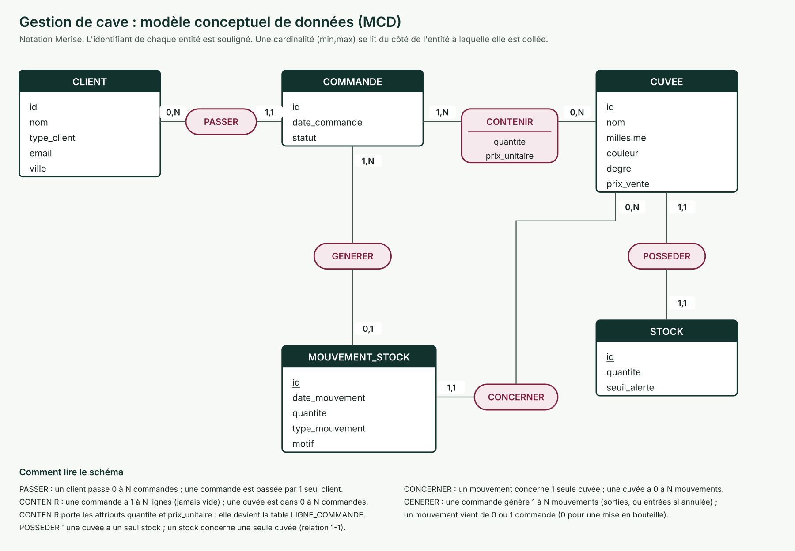
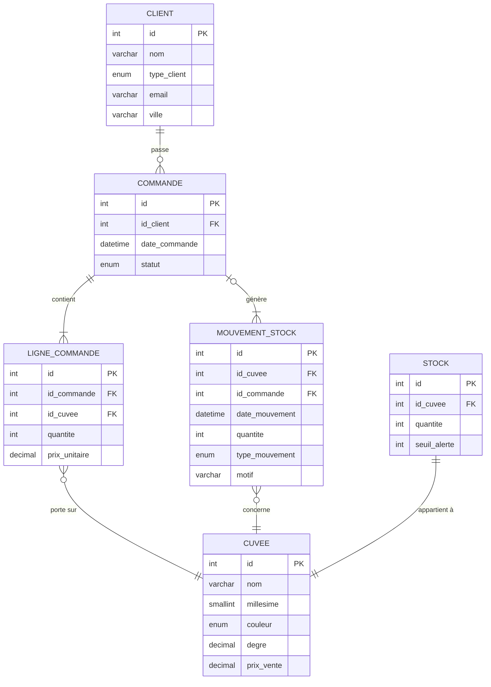

# Modèle de données : du MCD au MLD

Ce document présente le modèle conceptuel (MCD), puis sa traduction en modèle logique relationnel (MLD), qui est exactement ce que fait `database/01_schema.sql`.

## 1. Modèle conceptuel (MCD)

Le schéma se lit ainsi (cardinalités minimum, maximum) :

| Association | Côté A | Côté B | Lecture |
|---|---|---|---|
| **PASSER** | CLIENT (0,N) | COMMANDE (1,1) | Un client passe 0 à N commandes ; une commande est passée par un seul client. |
| **CONTENIR** | COMMANDE (1,N) | CUVEE (0,N) | Une commande contient 1 à N cuvées (jamais vide) ; une cuvée figure dans 0 à N commandes. L'association porte **quantité** et **prix unitaire**. |
| **POSSEDER** | CUVEE (1,1) | STOCK (1,1) | Une cuvée a un seul stock ; un stock concerne une seule cuvée. |
| **CONCERNER** | MOUVEMENT_STOCK (1,1) | CUVEE (0,N) | Un mouvement concerne une seule cuvée ; une cuvée a 0 à N mouvements. |
| **GENERER** | COMMANDE (1,N) | MOUVEMENT_STOCK (0,1) | Une commande génère 1 à N mouvements (des sorties à la vente, des entrées si elle est annulée) ; un mouvement vient de 0 ou 1 commande (aucune pour une mise en bouteille). |

## 2. Règles de passage du MCD au MLD

| Cas dans le MCD | Règle appliquée | Résultat |
|---|---|---|
| Entité | Une table, avec une clé primaire `id` | `cuvee`, `stock`, `client`, `commande`, `mouvement_stock` |
| Association 1-N (PASSER, CONCERNER, GENERER) | La clé primaire du côté « 1 » devient clé étrangère du côté « N » | `commande.id_client`, `mouvement_stock.id_cuvee`, `mouvement_stock.id_commande` |
| Association 1-1 (POSSEDER) | La clé étrangère est placée d'un côté et rendue **unique** | `stock.id_cuvee` avec `UNIQUE` |
| Association N-N **avec attributs** (CONTENIR) | Elle devient une **table**, qui reçoit les deux clés étrangères et les attributs de l'association | `ligne_commande (id_commande, id_cuvee, quantite, prix_unitaire)` |

## 3. Modèle logique (MLD)

Notation : **clé primaire en gras**, clé étrangère précédée de `#` et suivie de sa cible.

- `cuvee` (**id**, nom, millesime, couleur, degre, prix_vente)
- `stock` (**id**, #id_cuvee → cuvee, quantite, seuil_alerte)
- `client` (**id**, nom, type_client, email, ville)
- `commande` (**id**, #id_client → client, date_commande, statut)
- `ligne_commande` (**id**, #id_commande → commande, #id_cuvee → cuvee, quantite, prix_unitaire)
- `mouvement_stock` (**id**, #id_cuvee → cuvee, #id_commande → commande (peut être vide), date_mouvement, quantite, type_mouvement, motif)

Le détail de chaque colonne (type, valeur par défaut, règle) est dans le [dictionnaire de données](DICTIONNAIRE_DONNEES.md).

## 4. Diagramme relationnel

Ce diagramme est affiché directement par GitHub (format Mermaid). Les pattes de corbeau indiquent le côté « plusieurs ».

## 5. Contraintes d'intégrité

| Type | Contrainte | Rôle |
|---|---|---|
| Clés primaires | `id` de chaque table | Identifier chaque ligne de façon unique |
| Clés étrangères | 6 : `stock.id_cuvee`, `commande.id_client`, `ligne_commande.id_commande`, `ligne_commande.id_cuvee`, `mouvement_stock.id_cuvee`, `mouvement_stock.id_commande` | Aucune ligne ne peut pointer vers une ligne inexistante |
| Unicité | `cuvee (nom, millesime)`, `stock (id_cuvee)`, `client (email)`, `ligne_commande (id_commande, id_cuvee)` | Pas de doublon |
| Valeurs contrôlées | 8 `CHECK` : millésime, degré, prix de vente, stock ≥ 0, seuil ≥ 0, quantité de ligne > 0, prix de ligne > 0, quantité de mouvement > 0 | Le SGBD refuse une valeur absurde, même si le code se trompait |
| Listes fermées | `couleur`, `type_client`, `statut`, `type_mouvement` (type `ENUM`) | Seules les valeurs prévues sont acceptées |

## 6. Choix de modélisation à connaître

**Le total d'une commande n'est pas stocké.** Il se calcule avec `SUM(quantite × prix_unitaire)` dans la vue `v_commande_total`. Un total stocké pourrait devenir faux (une ligne modifiée, un total oublié) ; un total calculé ne peut pas l'être.

**Le prix est recopié dans la ligne de commande.** `ligne_commande.prix_unitaire` garde le prix du jour de la vente. Ce n'est pas une redondance à éliminer : c'est une donnée historique. Si `cuvee.prix_vente` change demain, les commandes passées gardent leur montant (la requête R10 en fait la preuve).

**La quantité en stock est une donnée dérivée, volontairement conservée.** Elle est égale à la somme des mouvements (entrées moins sorties). On la stocke dans `stock.quantite` parce que c'est la valeur que l'on lit à chaque commande, et parce que c'est ce qui permet au SGBD d'imposer `quantite >= 0`. En contrepartie, elle est mise à jour **dans la même transaction** que le mouvement, et la vue `v_controle_stock` vérifie à tout moment que les deux restent d'accord (écart nul).

**Une commande n'est jamais supprimée.** Elle passe au statut `annulee` et ses bouteilles retournent en stock par des mouvements d'entrée. L'historique commercial et la traçabilité des mouvements restent complets.

**Troisième forme normale.** Chaque colonne dépend de la clé de sa table et de rien d'autre : l'identité et la ville du client sont dans `client`, pas dans `commande` ; le nom et le degré d'une cuvée sont dans `cuvee`, pas dans `ligne_commande`. La seule donnée dérivée conservée est `stock.quantite`, expliquée ci-dessus, et elle est surveillée.

## 7. Correspondance avec le cahier des charges

Les 6 tables du cahier des charges sont toutes présentes. Quelques noms ont été précisés, et deux colonnes ajoutées :

| Cahier des charges | Dans la base | Raison |
|---|---|---|
| `Cuvee`, `LigneCommande`, `MouvementStock` | `cuvee`, `ligne_commande`, `mouvement_stock` | Noms en minuscules avec tirets bas : MySQL distingue majuscules et minuscules sous Linux mais pas sous Windows, donc une casse mixte est une source d'erreurs au déploiement |
| `Client.type` | `client.type_client` | `type` est un mot trop générique, source de confusion dans les requêtes |
| `Commande.date` | `commande.date_commande` | `date` est aussi le nom d'un type de données SQL : source de confusion |
| `MouvementStock.date`, `MouvementStock.type` | `mouvement_stock.date_mouvement`, `mouvement_stock.type_mouvement` | Même raison |
| (absent) | `commande.statut` | Nécessaire pour annuler une commande sans la supprimer |
| (absent) | `mouvement_stock.id_commande`, `mouvement_stock.motif` | Relier chaque sortie ou entrée à la commande qui l'a provoquée, et expliquer en clair les autres |
